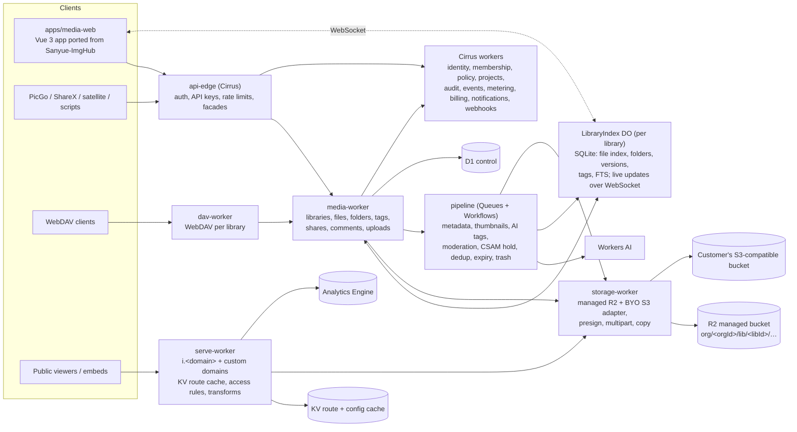
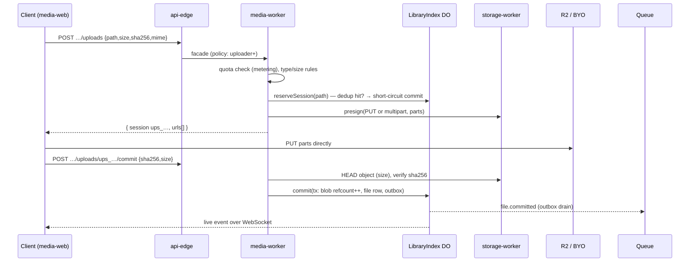
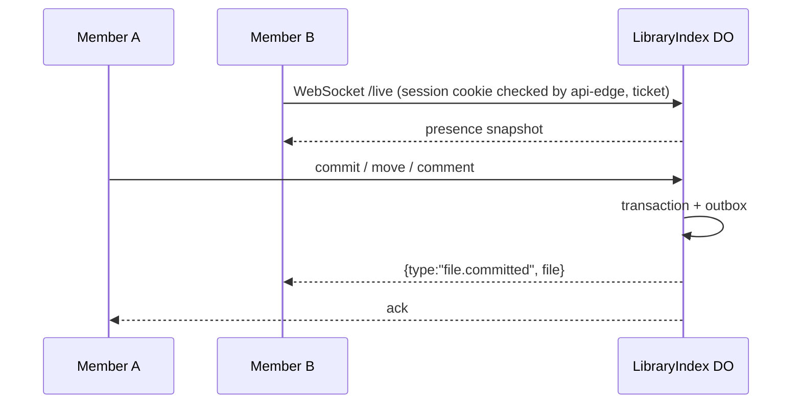

# pixvault-team-media: design

Port sources are pinned: `MarSeventh/CloudFlare-ImgBed@611153e` (behaviour, options, API shapes) and
`MarSeventh/Sanyue-ImgHub@1621525` (UI). Every derived file carries
`// Derived from MarSeventh/<repo>@<ref>:<path> (MIT), modified.`

## 0. Architecture



Everything runs on one Cloudflare account through the workspace's Cloudflare connection. The only external systems
are BYO buckets that customers choose. Cirrus provides identity, orgs, roles, policy, invites, projects, audit,
events, settings, flags, metering, quotas, Polar billing, email, webhooks, API keys and the rate-limited `api-edge`.

## 1. The resource model

### 1.1 Tenancy

- **Org = team** (Cirrus `org_…`). Org roles: owner, admin, member, viewer.
- **Library = Cirrus project** (`prj_…`) with a `libraries` row (`lib_…`) carrying media settings. One default
  library ("Library") is created with each org.
- **Org roles, in Cirrus's names:** `owner`, `admin`, `builder` (the brief's "member"), `viewer` and
  `billing_admin`. Billing admins get no library access.
- **Library roles:** `manager` (settings, storage, domain, library members), `editor` (upload, organise, rename,
  move, trash, share), `uploader` (upload, see own uploads), `viewer` (browse, download). Org owners and admins are
  managers of every library. Members see libraries they are added to, or those marked `everyone_in_org`, which
  grants org builders `editor` and org viewers `viewer`. **Guests** are outside the org and hold exactly one
  library role (`uploader` or `viewer`) in one library. They join by **email invitation** (`lbi_…`, 14 days),
  accepted by a signed-in user whose verified email matches. Every check goes through `policy-worker`: media-worker
  sends `library_role` facts beside the org role facts, and `packages/policy-engine/src/library.ts` decides.
- **Scope invariant:** every D1 row, R2 key, KV key, Queue message, DO, Workflow instance, API key, WebDAV
  credential, share link and domain names exactly one org, and usually one library. Managed R2 keys always begin
  `org/<orgId>/lib/<libraryId>/`; BYO keys begin with the library's configured prefix. A file id or path from
  library A never resolves in library B on any surface, including serving, WebDAV, random, share links and domains.

### 1.2 D1 control tables (`packages/db` migration `200_media_control`)

Every table has `org_id`, `created_at`, `updated_at`. As built, each name carries the `media_` context prefix
(`media_libraries`, `media_library_members`, …), as Cirrus names its tables, and guest invitations have their own
table:

```
library_invitations  id lbi_…  library_id  email_lower  role(uploader|viewer)  expires_at  accepted_at
                     accepted_by  revoked_at   UNIQUE open (org_id, library_id, email_lower)
```

```
libraries          id lib_…  project_id prj_…  slug  name  visibility_default(public|private)
                   everyone_in_org  moderation_level(off|standard|strict)  retention_days
                   settings_json  UNIQUE(org_id, slug)
library_members    library_id  principal_kind(member|guest)  principal_id usr_…
                   role(manager|editor|uploader|viewer)  UNIQUE(library_id, principal_id)
storage_backends   id stb_…  library_id  kind(managed-r2|s3-compatible)  endpoint  region  bucket
                   prefix  credential_ref(envelope-encrypted)  status  last_check_at
domains            id dom_…  library_id  hostname UNIQUE  custom_hostname_id  status  verified_at
share_links        id shl_…  library_id  target_kind(file|folder|collection)  target_id  mode(view|download)
                   token_hash  password_hash  expires_at  max_downloads  downloads  revoked_at
upload_links       id upl_…  library_id  folder_path  token_hash  limits_json  requires_review
                   expires_at  revoked_at
dav_credentials    id dav_…  user_id  library_ids_json  password_hash  last_used_at  revoked_at
serve_routes       hostname_or_lib  path_hash  library_id      -- mirror of KV, for rebuilds
abuse_cases        id abc_…  file_ref  reporter_email  reason  status  action  handled_by  handled_at
import_jobs        id imp_…  library_id  source(imgbed-export|telegram|discord|hf|webdav|s3)
                   status  stats_json
```

`abuse_cases` is platform-scoped: it keeps `org_id` for the file's owner, but only platform admins read it.

### 1.3 `LibraryIndex` Durable Object (one per library, SQLite storage)

The DO is the system of record for a library's metadata. Its name is `org:<orgId>:lib:<libraryId>`, and every
method re-checks that the caller's `(orgId, libraryId)` matches the name it was addressed by.

```
files            id fil_…  path  name  folder_id  blob_sha256  size  mime  width  height  duration  blurhash
                 visibility  status(processing|held|public|private|flagged|trashed)  expires_at
                 uploaded_by  version  UNIQUE(path) WHERE status != 'trashed'
blobs            sha256 PK  object_key  backend_id stb_…  refcount
versions         file_id  version  blob_sha256  size  created_by  created_at
folders          id fld_…  parent_id  path UNIQUE  name
tags             id tag_…  name UNIQUE
file_tags        file_id  tag_id  source(user|ai)
comments         id cmt_…  file_id  author  body  mentions_json  resolved_at
collections      id col_…  name  public_gallery
collection_items collection_id  file_id  position
upload_sessions  id ups_…  path  size  sha256  multipart_upload_id  parts_json  expires_at  created_by
files_fts        FTS5(name, path, tags, ai_tags, description)
outbox           seq  kind  payload_json  delivered_at      -- KV routes, events, queue jobs
presence         (in memory; hibernating WebSockets carry user id + cursor)
```

Every write (commit, move, rename, delete, restore, tag, comment) is one SQLite transaction that also appends to
`outbox`. The DO's alarm drains the outbox into KV (`route:<hostOrLib>:<pathHash>`), Queues (`file.committed`) and
Cirrus events, at least once and idempotent by `seq`. Metadata is exported nightly to
`org/<orgId>/lib/<libId>/_index/<date>.sqlite`, with an alarm at 70% of the DO size limit.

### 1.4 Storage objects

```
org/<orgId>/lib/<libId>/blob/<sha256>          the bytes; deduplicated per library
org/<orgId>/lib/<libId>/thumb/<sha256>/<w>.webp derived
org/<orgId>/lib/<libId>/_index/<date>.sqlite    nightly DO export
org/<orgId>/lib/<libId>/_tmp/<ups_id>/…         zip bundles, import staging (TTL by lifecycle rule)
```

Id prefixes: `lib_ stb_ dom_ shl_ upl_ dav_ abc_ imp_` (D1), `fil_ fld_ tag_ cmt_ col_ ups_` (DO). All are
`<prefix>_<32 hex>`, as Cirrus's `packages/db/src/ids` produces.

## 2. The API

### 2.1 Cirrus facades (the app), in `api-edge`

`{ data, meta }` envelopes, cursor pagination, `Idempotency-Key` on writes and rate limits, all as Cirrus does them.
Error shape `{ error: { code, message, details, requestId } }`. A denied read is `404`, never `403`.

```
GET    /v1/organizations/{orgId}/libraries
POST   /v1/organizations/{orgId}/libraries
GET    /v1/organizations/{orgId}/libraries/{libId}
PATCH  /v1/organizations/{orgId}/libraries/{libId}                    settings, rules, moderation
GET|PUT|DELETE /v1/organizations/{orgId}/libraries/{libId}/members[/{principalId}]
GET    /v1/organizations/{orgId}/libraries/{libId}/files?folder=&q=&tag=&status=&cursor=
GET|PATCH|DELETE /v1/organizations/{orgId}/libraries/{libId}/files/{fileId}
POST   /v1/organizations/{orgId}/libraries/{libId}/files/{fileId}/restore
POST   /v1/organizations/{orgId}/libraries/{libId}/files:batch        move|tag|visibility|trash|zip
POST   /v1/organizations/{orgId}/libraries/{libId}/files/{fileId}/signed-url
GET|POST /v1/organizations/{orgId}/libraries/{libId}/folders
POST   /v1/organizations/{orgId}/libraries/{libId}/uploads            → session + presigned part URLs
POST   /v1/organizations/{orgId}/libraries/{libId}/uploads/{upsId}/parts
POST   /v1/organizations/{orgId}/libraries/{libId}/uploads/{upsId}/commit   { sha256, size }
GET|POST|DELETE …/share-links  …/upload-links  …/collections  …/comments
GET|PUT  …/storage    POST …/storage:test    POST …/storage:migrate
GET|POST|DELETE …/domains
GET    /v1/organizations/{orgId}/usage
GET    /v1/organizations/{orgId}/libraries/{libId}/live              WebSocket upgrade → LibraryIndex
```

### 2.2 Public API `/api/v1` (API keys)

The same resources under `/api/v1/libraries/{libId}/…`, authenticated by Cirrus API keys scoped to an org and
optionally to one library and role (upload-only keys for CI). An OpenAPI 3.1 document is generated from
`packages/contracts` and published at `/api/v1/openapi.json`.

### 2.3 ImgBed-compatible upload API

`POST /upload` and the chunked variants (`?chunked=true` init, chunk and merge) keep the form fields, query options
(`uploadChannel` ignored, `uploadNameType`, `uploadFolder`, `returnFormat`, `autoRetry`, `serverCompress`) and
response JSON of `functions/upload/index.js` at `611153e`. Requests go to `https://api.<domain>/l/<libSlug>/upload`
with the token in `authCode` (query or header) or `Authorization: Bearer`; the token is an upload-scoped Cirrus API
key. Internally the request becomes an upload session, a single PUT through the Worker (these clients can't do
presigned uploads) and a commit. Contract tests pin the response format (PV-F).

### 2.4 WebDAV

`dav.<domain>/<libSlug>/` in `dav-worker`, ported from `functions/dav/**`. It supports PROPFIND, GET, HEAD, PUT,
DELETE, MKCOL, MOVE, COPY and OPTIONS. Auth is HTTP Basic with a **per-user app password** (`dav_credentials`),
mapped to the user's library role on each request.

### 2.5 Serving (`serve-worker`)

```
GET i.<domain>/<libSlug>/<path>[?w=&h=&fit=&f=&q=&blur=&preset=]     public files
GET i.<domain>/<libSlug>/<path>?sig=&exp=                             private files (HMAC-SHA256, per-library key)
GET <customHost>/<path>                                               custom domain → one library
GET i.<domain>/<libSlug>/random[?folder=&type=&form=]                 random-image API (if enabled)
GET s.<domain>/<token>                                                share-link landing (password prompt)
```

Public serving is one KV read (`route:…`) plus one storage read, with `Cache-Control: public, max-age=31536000,
immutable` on content-addressed paths and an ETag of the SHA-256. Access rules run before the storage read:
allowed referrers, IP block and allow lists, the blocked-file list (451) and a per-IP rate limit. Transforms use
Cloudflare Image Transformations (`cf.image`) limited to the library's presets. Where that isn't available,
ImgBed's in-Worker `imageTransform.js` is the fallback. Each serve writes an Analytics Engine data point
(library, file, bytes, referrer host, country) and never an IP address.

### 2.6 Sequences

**Direct upload**



**Public file**

```mermaid
sequenceDiagram
  participant V as Viewer
  participant SV as serve-worker
  participant K as KV
  participant S as storage-worker / R2 binding
  V->>SV: GET i.domain/lib/path.png
  SV->>SV: access rules (referrer, IP, rate)
  SV->>K: route:lib:hash(path)
  K-->>SV: {key, backend, visibility=public, etag, type}
  SV->>S: get(key)
  S-->>SV: body
  SV-->>V: 200, immutable cache, ETag; AE data point
```

**Private file by signed URL**

```mermaid
sequenceDiagram
  participant U as Member
  participant M as media-worker
  participant SV as serve-worker
  participant K as KV
  U->>M: POST …/files/fil_…/signed-url {ttl}
  M->>M: policy viewer+; HMAC(libKey, lib|path|exp)
  M-->>U: https://i.domain/lib/path?sig=…&exp=…
  U->>SV: GET with sig, exp
  SV->>K: route + library signing key version
  SV->>SV: verify HMAC, exp > now (constant-time)
  SV-->>U: 200 private, no-store
```

**A teammate's live view**



## 3. The app

`apps/media-web` is Sanyue-ImgHub (Vue 3 + Element Plus) at `1621525`, served by Workers Static Assets at
`app.<domain>`. It signs in through Cirrus identity (the same session as the console) and is restyled to the
Pixvault brand in light and dark themes, with the upstream brand assets and default backgrounds removed. Org admin
(members, invites, roles, billing, audit, API keys) stays in the Cirrus console (`apps/web-console-next`), linked
from the app's org menu. Using a Vue app beside a Next.js console is deliberate: it reuses an MIT UI verbatim (PV-G).

Screens: (1) library switcher and home; (2) upload (drag and drop, paste, URL, folder, progress, link formats URL,
Markdown, HTML and BBCode, visibility); (3) library browser (tree, grid and list, thumbnails, presence, bulk bar,
filters, FTS search); (4) file drawer (preview, links, metadata, tags, versions, comments, activity, share);
(5) share dialog; (6) library settings (storage wizard, domain wizard, rules, moderation, retention, presets,
random API); (7) review queue; (8) developer (API keys, client configs, WebDAV passwords, webhooks, MCP URL);
(9) usage; (10) public pages (file view with "Report", gallery, share landing, 451, abuse, terms). WCAG 2.2 AA
(axe in CI), usable down to 390 px.

## 4. Events, secrets and integrations

- **Cloudflare products:** R2 (managed bucket per environment), Queues (`file-committed`, `file-dlq`), Durable
  Objects (`LibraryIndex`), Workflows (`ProcessFileWorkflow`, purge, migrate, export, import, zip), Workers AI
  (tags, description, moderation), Image Transformations, Analytics Engine (`pixvault_serves`), SSL for SaaS custom
  hostnames, plus Cirrus's D1, KV and email.
- **Secrets** (workspace `secret://` refs, never in the repo): `MEDIA_KEK` (key-encryption key for per-org data
  keys), `SIGNING_ROOT` (derives per-library HMAC keys with a version), the custom-hostname zone id, and the
  optional `BYO_TEST_BUCKET_*` for CI. BYO credentials are envelope-encrypted under the org's data key and decrypted
  only inside `storage-worker`, for one request.
- **Audit:** library create/update/delete, member and role changes, storage and domain changes, share-link
  create/revoke, API key and app-password create/revoke, takedowns.
- **Webhooks:** `file.uploaded`, `file.updated`, `file.deleted`, `file.restored`, `file.flagged`, `share.opened`,
  `quota.warning`.
- **Metering:** `storage.bytes` (managed only), `uploads.count`, `transforms.count`, `ai.tags`, plus serve
  bandwidth from Analytics Engine roll-ups.
- **Pipeline:** `ProcessFileWorkflow` runs metadata and EXIF (GPS stripped unless the org keeps it), then the
  thumbnail and blurhash, then safety (moderation; free public uploads stay `held` until it passes), then AI tags,
  then the index and FTS update, then events. It retries with backoff, and a DLQ goes to platform admin with replay.
- **CSAM:** Cloudflare's CSAM Scanning Tool is enabled on every serving hostname (a dashboard step, in WAITING).

## 5. Out of scope (v1)

Telegram, Discord or Hugging Face as storage (import only, PV10); video transcoding; real-time co-editing of
images; desktop and mobile apps; self-hosted Docker and Pages editions; cross-org deduplication.

## 6. Alternatives rejected

- **Keep ImgBed's KV/D1 file index (with `indexManager`) and add `org_id` columns.** Rejected. Listing stays
  eventually consistent and slow, and there are no transactions across a move of many files. Live updates would
  need a second system. The per-library SQLite DO gives one writer per library, transactions, FTS5 and WebSockets
  in one place. The cost is a per-library write ceiling (PV-C), which is measured in PV2.
- **One D1 database for all metadata, sharded by org.** Rejected. D1 is a single writer per database, so every
  org's uploads would contend on one database. It also has no WebSocket fan-out, and its size cap is shared.
  D1 stays the control plane, where rows are few and reads are by token hash or id.
- **Keep Telegram, Discord and Hugging Face as storage "channels".** Rejected. Their terms forbid use as a file CDN
  for third parties, they offer no deletion guarantees and no SLA, and a hosted product can't promise retention,
  takedown or BYO isolation on top of them. They stay as one-way import sources (PV10).
- **Proxy every upload through the Worker, as ImgBed does.** Rejected. It hits Worker body limits and CPU time on
  large files and pays egress twice. Presigned direct uploads with a commit-time hash check scale to 2 GB and
  resume. The ImgBed-compatible `/upload` keeps a Worker-proxied path only for clients that can't presign (PV9).
- **Rewrite the app in Next.js inside the Cirrus console.** Rejected for v1. Sanyue-ImgHub is a complete, MIT,
  well-tested Vue UI for exactly these screens. Porting it verbatim saves several milestones; the cost is two
  front-end stacks (PV-G, accepted).
- **Cross-org dedup by global SHA-256.** Rejected. It leaks whether a file exists in another org (a confirmation
  oracle) and couples deletes across tenants. Dedup is per library.
